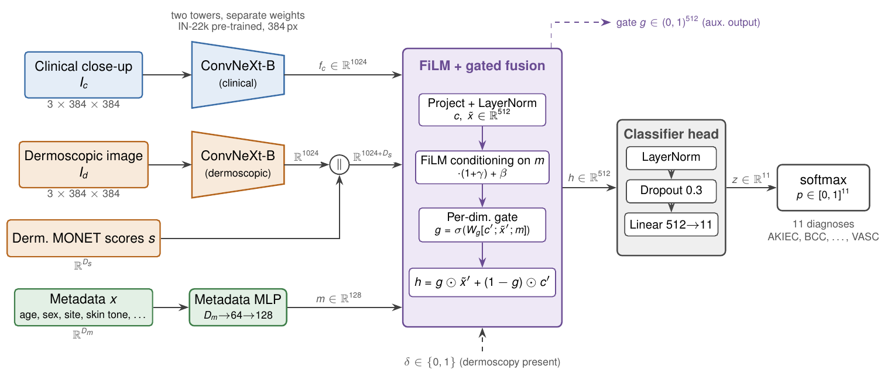
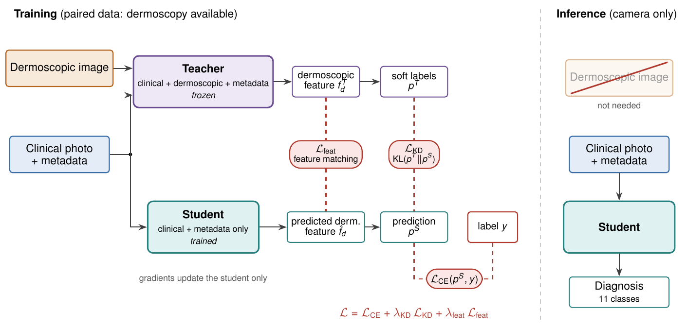

# MILK10k: Multimodal-to-Clinical Knowledge Distillation

Doctors can diagnose skin lesions better with a special zoomed-in image called a **dermoscopic
image**. But usually only a **normal photo** is available.

So we train a **teacher** model that sees both images and the patient's details. Then we train
**student** models that learn from the teacher but need only the normal photo and the patient's
details.

Task: 11-class diagnosis on [MILK10k](https://doi.org/10.34970/648456) (5,240 training and 479 test
lesions).

## Teacher: `Fusion-Teacher/`



Two ConvNeXt-Base encoders read the clinical photo and the dermoscopic image, and a small MLP
encodes the metadata. **FiLM** conditions both image features on the metadata, and a **gate** decides
how much to trust dermoscopy versus the clinical photo.

## Students: `KNN-Student/` and `Halluc-Student/`



The frozen teacher guides the student during training through its soft predictions and features. At
test time the student needs only the clinical photo and the metadata.

- **KNN-Student:** the final decision is a kNN vote over a bank of training lesions.
- **Halluc-Student:** a "hallucinator" predicts the teacher's dermoscopic feature from the photo.

Each folder has its own README with the details.

## Checkpoints and data

| | Link |
|---|---|
| Checkpoints | [praveenkinthali003/milk10k-distillation-checkpoints](https://huggingface.co/praveenkinthali003/milk10k-distillation-checkpoints) |
| Data | [praveenkinthali003/milk10k-distillation-data](https://huggingface.co/datasets/praveenkinthali003/milk10k-distillation-data) |

```bash
git clone https://github.com/SnehaLakhlan/isic-milk10k-multimodal-to-clinical-distillation
cd isic-milk10k-multimodal-to-clinical-distillation
pip install -r Halluc-Student/requirements.txt huggingface_hub

hf download praveenkinthali003/milk10k-distillation-data --repo-type dataset --local-dir ../milk10k-data
hf download praveenkinthali003/milk10k-distillation-checkpoints --local-dir ../ckpts
```

## Reproducing the results

**1. Set the paths** in each model's `config.yaml`. For example, `Halluc-Student/config.yaml`:

```yaml
teacher_work_dir: ../../ckpts/Fusion-Teacher        # students only
data:
  train_meta_csv: ../../milk10k-data/milk10k/MILK10k_Training_Metadata.csv
  train_gt_csv:   ../../milk10k-data/milk10k/MILK10k_Training_GroundTruth.csv
  train_img_dir:  ../../milk10k-data/milk10k/MILK10k_Training_Input
  test_meta_csv:  ../../milk10k-data/milk10k/MILK10k_Test_Metadata.csv
  test_img_dir:   ../../milk10k-data/milk10k/MILK10k_Test_Input
work_dir: ../../ckpts/Halluc-Student                # the downloaded model folder
```

**2. Run with our checkpoints**, from inside each model's folder:

| | Fusion-Teacher | KNN-Student | Halluc-Student |
|---|---|---|---|
| Validation results | `python tune_thresholds.py` | `python evaluate.py` | `python evaluate.py` |
| Test predictions | `python predict.py` | `python predict.py` | `python predict.py` |

**3. Or retrain from scratch.** Train the teacher first, then the students. Set `work_dir` to a new
folder.

```bash
cd Fusion-Teacher && python train.py && python tune_thresholds.py
cd ../Halluc-Student && python train.py && python evaluate.py
```

## Results

5-fold out-of-fold macro-F1 on the training lesions:

| Model | Inputs | Macro-F1 |
|---|---|---|
| Fusion-Teacher | clinical + dermoscopic + metadata | 0.578 |
| Teacher, dermoscopy hidden | clinical + metadata | 0.481 |
| KNN-Student | clinical + metadata | 0.493 |
| **Halluc-Student** | clinical + metadata | **0.504** |

Both students beat the clinical-only baseline without seeing a dermoscopic image.

## Citation

- **Data:** MILK study team (2025). *MILK10k* [Data set]. ISIC Archive. https://doi.org/10.34970/648456
- **Paper:** https://doi.org/10.1016/j.jid.2025.06.1594
